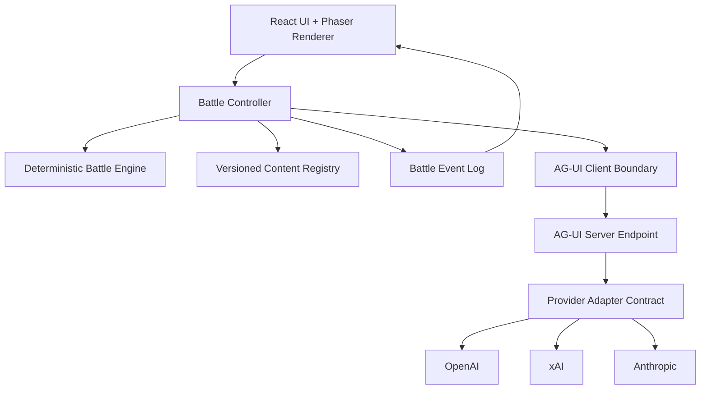

# Pokaimon: Game Design Document

**Document:** docs/GAME_DESIGN.md  
**Status:** Approved product direction; detailed mechanics are design proposals until playtested  
**Version:** 1.0  
**Baseline date:** 2026-11-19  
**Companion:** [Implementation Plan](./IMPLEMENTATION_PLAN.md)

## 1. One-sentence pitch

**Pokaimon is a browser-based, turn-based creature-battle game where AI models are collectible characters, real-world problems are encounters, and moves teach useful AI capabilities and strategies.**

The entertainment loop is a fun, expressive handheld-style battle. The learning loop is choosing the right model and capability for a specific problem, observing a credible outcome, and understanding the tradeoff.

**Tagline (working):** Master your models. Battle real-world problems.

## 2. Product promise and design pillars

1. **Fun first:** The battle has meaningful choices, readable combat feedback, polished sprite animations, concise dialogue, and satisfying wins and losses.
2. **Real AI literacy:** Every move maps to a real reasoning strategy, supported tool workflow, or documented capability. The game explains when a move is useful and what it requires.
3. **Truthful outcomes:** Simulation outcomes are clearly labeled fictional game outcomes. Actual task completion requires real execution and external verification.
4. **Model-agnostic:** Characters, moves, task definitions, and battle logic are data-driven. AG-UI is the interaction boundary for agent-connected runs; provider adapters keep API differences out of the game.
5. **Original, reusable universe:** One battle system drives new models, enemies, moves, difficulty levels, shareable replays, and eventually real work.
6. **Simple and composable:** A small complete game before online accounts, agent orchestration, persistent computers, or paid inference.

### What the game should teach

A player who beats a research task should understand *why* source retrieval and verification mattered. A player who beats a coding bug should understand that diagnosis, making a change, and testing are different steps. A player who chooses the wrong move should get actionable feedback rather than an arbitrary “not very effective.”

### Explicit non-goals for initial MVP

No persistent-cloud-computer agents, autonomous long-running tasks, multiplayer, gacha purchases, marketplaces, model training, crypto, leaderboard ranking of real providers, production code execution, or autonomous access to user accounts. A replay/video export is a later slice.

## 3. Audience and platforms

Primary audience: people curious about AI who know games and memes, developers comparing models, and creators who want short shareable battle clips.

Initial delivery: install-free responsive web app, portrait-first on Android and iPhone with a desktop layout. Mouse, touch, and keyboard support. No signup to complete a battle. English for MVP.

Target first-session experience: launch, choose a model, encounter TASK, select four moves, win or lose, read one useful explanation, and retry. Aim for a 2–4 minute first play session; tune by testing.

## 4. Universe and presentation

**Playable creatures = specific AI model versions.** A model has a recognizable original sprite, model/provider attribution, four equipped moves, a balance profile, and a short factual capability card.

**Wild encounters = problems.** Examples are TASK, BUG, RESEARCH REQUEST, MATH PROBLEM, LEGACY CODE, HALLUCINATION, and SCOPE CREEP. Each has a task objective, stages, resistances, and a counter-pattern.

**Moves = AI techniques or tool-enabled workflows.** Names should be recognizable as real AI capabilities: Deep Think, Max Reasoning, Deep Research, Code Execution, Self-Correction, Context Recall, Extended Thinking, Parallel Search, and eventually Swarm. Names alone do not imply all models expose a native API feature of that name.

**Trainer = player.** The player chooses their strategy and watches feedback. Trainer artwork should be an original design.

**Tone:** Playful, educational, lightly memeable; no unsupported disparagement, endorsement, or implied company partnership.

### Visual direction

- 2D pixel-art battle, retro handheld RPG feel with original terrain, UI, character sprites, enemy illustrations, iconography, audio, and battle text.
- 9:16-oriented battle stage, with responsive safe areas for portrait phone screens and a centered stage on desktop.
- Fixed side-view camera; model on player-side platform, problem on opposing platform; readable health/progress/status panels.
- Classic encounter entrance, typed text, grid-snapped cursor, summon animation, impact flashes, brief shake, progress drain, and win/lose animation.
- Animations are deterministic sequences driven by battle events, not generated ad hoc on every turn.
- Original chiptune-inspired soundtrack and sound effects, with mute and reduced-motion controls.
- Brand logos can appear only where permitted by applicable trademark/usage rules; original creature appearances are the default. Do not copy Pokémon characters, sprites, Poké Balls, screens, music, names, or trade dress.

## 5. Starting roster

The **initial three character records** are versioned and replaceable. Their exact provider model IDs, availability, costs, and tool support must be independently verified when live integration is enabled.

| Playable character | Provider | Gameplay identity (design proposal) | Source |
| --- | --- | --- | --- |
| GPT-6.2 Astra | OpenAI | Strong deliberate reasoning and structured problem solving | https://developers.openai.com/api/docs/models/gpt-6.2-astra |
| Grok 4.7 | xAI | Fast strategic adaptation and tool-aware problem solving | https://x.ai/news/grok-4-7 |
| Claude Fable 5.2 | Anthropic | Thorough technical analysis, contextual reasoning, code review | https://platform.claude.com/docs/en/models/fable-5-2/overview |

The user-suggested Fable 5.5 is not treated as an available model until an official source confirms it. Release/version metadata is **content data**, not hardcoded game logic. Do not assert that a speculative balance advantage is an objective benchmark advantage.

### Four equipped moves per character (initial design, subject to balancing)

| Character | Four moves |
| --- | --- |
| GPT-6.2 Astra | Deep Think; Deep Research; Code Execution; Self-Correction |
| Grok 4.7 | Max Reasoning; Context Recall; Parallel Search; Code Review |
| Claude Fable 5.2 | Extended Thinking; Context Recall; Code Review; Self-Correction |

A **move registry** defines each move once and allows multiple characters to equip it. Tool-dependent moves are labeled accordingly. For example, Deep Research or Parallel Search requires a retrieval/search tool to *execute* during a connected run, and Code Execution requires a controlled execution tool. In the initial simulation game, the move represents the workflow concept and produces only a fictional, clearly labeled battle effect.

**Swarm** is a priority future move and excellent branding, but true multi-agent parallel delegation is reserved for a later agent-enabled release. It can appear as an informational locked move, not a falsely claimed native capability.

## 6. Battle vocabulary and types

Do not mimic a specific franchise's type chart. Use categories that teach genuinely different strategies:

- **Reasoning:** breaking down hard problems, math, planning, diagnosing.
- **Research:** retrieval, source comparison, evidence synthesis.
- **Coding:** implementing and reviewing code, building tests.
- **Verification:** checking claims, evaluating outcomes, correcting errors.
- **Context:** using long history and relevant information.
- **Orchestration (future):** parallel work, delegation, tool routing.

These categories tag moves and encounters; they do not guarantee success by themselves. A task's stages and requirements determine usefulness.

### Model stats (game abstractions, not provider benchmark claims)

- **Focus:** strength for multi-step reasoning stages.
- **Coverage:** usefulness across task categories.
- **Precision:** resistance to unverified claims in simulation.
- **Tempo:** fictional turn economy.
- **Budget:** action points consumed by moves.

Use explicit “game balance” labeling anywhere values are shown. Future factual comparison cards can cite dated external test results separately. Never convert marketing statements into unsourced power rankings.

## 7. Core gameplay loop

1. **Encounter:** A wild problem appears, with clear objective and stage requirements.
2. **Inspect:** The player sees its category, level, and a small hint about the skills needed. Harder encounters expose clues only after attempts.
3. **Choose:** Pick one of the unlocked models; preview its four equipped moves and strengths.
4. **Act:** Select a move, spend action points, and receive animated deterministic feedback.
5. **Respond:** Enemy performs a predictable or telegraphed action, such as introducing ambiguity, a regression, or new information.
6. **Advance:** Move through objective stages. Progress reduces the task bar only for relevant, stage-appropriate actions.
7. **Resolve:** Victory requires completing the required stages. Defeat occurs if focus, turns, or budget are exhausted.
8. **Learn:** A compact post-battle explanation shows which choices worked, which wasted resources, and how the underlying AI method applies in reality.
9. **Retry:** Try a different model or sequence and compare outcomes.

Each action in the initial game is a simulation. The game never claims a real model ran unless a connected run occurred and evidence is available.

## 8. Battle system v1: stage-based progress

Design around **task completion stages** so battles represent realistic workflows.

Example: **BUG Lv.5**
- Stage A: Diagnose the bug.
- Stage B: Propose and apply a fix (simulation only at MVP).
- Stage C: Test and verify.
- A reasoning move helps A but cannot finish B or C by repeated use.
- A coding move can advance B after A.
- A verification move advances C once the simulated fix is ready.
- BUG may use Regression, increasing verification burden.

Example: **RESEARCH REQUEST Lv.5**
- Stage A: Identify question and search terms.
- Stage B: Gather relevant evidence (requires research category).
- Stage C: Cross-check claims and produce a cited conclusion.
- Pure reasoning alone cannot satisfy source gathering.

Example: **TASK Lv.5**
- Stage A: Understand and plan.
- Stage B: Execute the task approach.
- Stage C: Verify done.
- Gives first-time players practice using thinking, execution, and self-checking.

### Turn mechanics, initial tunable specification

- One player action, then one encounter response, until win/lose.
- Each move has a category, cost (AP), target-stage tags, an effect, an animation ID, an explanation, and optional prerequisites.
- Start with 100 task progress points to clear, 6 AP per battle, and 8-turn cap as **starting playtest numbers**, not validated balance.
- Effective move: clears a defined stage amount or status based on stage fit and prerequisites.
- Ineffective move: small/no progress with a specific educational explanation; no random punishment.
- Enemy actions add an obstacle, drain AP, or change stage requirements according to an explicit deterministic schedule.
- A stage is only marked complete when its mandatory conditions are satisfied; 0 HP alone cannot bypass verification.
- Victory: all required stages complete within available budget. Defeat: budget/turns exhausted or explicit encounter failure state.
- No hidden model bias or unverified ranking masquerading as factual capability differences.
- Prefer deterministic reproducible seeded effects. Introduce chance only when it adds meaningful gameplay and remains testable.

**Reference balancing formula (proposed):**

Progress = base move power × stage-fit modifier × status modifier, clamped to remaining stage progress.

Typical proposed stage-fit modifiers: strong 1.25, neutral 1.0, weak 0.25, prerequisite missing 0. The task stage's hard requirements override numerical HP calculations. Tune with playtests before calling any values final.

### Required combat state

Battle ID and seed; encounter ID/version; selected model ID/version; current stage; stage progress and mandatory flags; AP; turn; current statuses; queued actions; outcome; chronological event log. All updates must flow through the authoritative reducer/state machine.

Suggested states: START -> ENCOUNTER -> MODEL_SELECT -> PLAYER_TURN -> RESOLVE_MOVE -> ENEMY_TURN -> CHECK_OUTCOME -> PLAYER_TURN or VICTORY/DEFEAT -> LEARN -> RETRY.

Animations observe committed battle events. Animation callbacks cannot decide damage or advance authoritative game state.

## 9. Initial encounter library

| Enemy | Learning objective | Sample enemy action |
| --- | --- | --- |
| TASK | Plan, act, verify | Scope Shift adds one condition |
| BUG | Diagnose, fix, test | Regression requires retest |
| RESEARCH REQUEST | Retrieve, corroborate, cite | Source Conflict adds verification |
| MATH PROBLEM | Reason stepwise and check | Hidden Assumption changes requirement |
| HALLUCINATION | Demand evidence and self-correct | Confident Claim creates a false lead |

These five ship in the MVP after the single-encounter vertical slice. LEGACY CODE, RATE LIMIT, DEADLINE, CONTEXT OVERFLOW, CAPTCHA, TOKEN DRAIN, and SCOPE CREEP are expansion concepts.

Enemies must represent recognizable *problems*, not fictitious actual model defects. A move's lesson is stored alongside the encounter's requirements.

## 10. A complete first battle: TASK tutorial

- Player presses **Play**; TASK Lv.5 enters with original chiptune and a quick sprite slide.
- Dialogue: “A wild TASK appeared! Plan it, execute it, verify it.”
- Player picks one of the three models and sees four moves.
- **Deep Think** advances the planning stage and explains decomposition.
- **Code Execution** (simulation) advances the execution stage only when the task is a coding flavored TASK; a general TASK uses an appropriate available execution strategy instead. The game should not teach that all tasks are coding tasks.
- TASK uses **Scope Shift**; requirements update visibly.
- **Self-Correction** or another verification move completes the check stage after prerequisites.
- TASK is defeated; a lesson card shows the effective sequence and why each capability mattered.
- On retry, a model or move change produces different legitimate tradeoffs while preserving a solvable path.

**Tutorial constraint:** The tutorial roster/loadout must have at least one complete feasible solution for each selectable model. If a model lacks a mandatory move category, the tutorial must offer a generic action or teach the player to change characters before battle. Test feasibility from definitions, not manual guesswork.

## 11. Content and progression

**MVP:** Five encounters, three characters, four moves each, a clear tutorial, optional retry, and basic local saved progress. No account required.

Rewards prioritize knowledge rather than grind: encounter cleared, a new tactic understood, an alternate solution discovered, or fewer wasted actions. A simple field guide records encountered enemies and discovered capability lessons. Unlock harder encounters after clearing prerequisite tutorials.

**Later:** More current model versions, alternate move sets, creature evolutions interpreted as verified model version upgrades, curated challenge packs, shareable replay cards, and optional difficulty modes. New models should be registerable without migrating battle engine code.

Content records carry a published/updated date, source URLs, confidence or verification status, and a stable version. Content review is required when provider APIs or capabilities change.

## 12. Interfaces and UX specification

Initial screens:

1. **Home:** Play, Field Guide, Settings. Fast first play.
2. **Model Selection:** Three original sprites with name, provider, four moves, gameplay stats, and a “game balance” note.
3. **Battle:** Fixed background, enemy/progress UI, player sprite, dialogue box, 2 × 2 move grid, AP/turn indicator, and brief effectiveness cue.
4. **Result:** Victory/defeat, stage recap, move effectiveness, one actionable AI lesson, retry/next encounter.
5. **Field Guide:** Encounter and move encyclopedia with links to documentation when available.
6. **Settings:** Sound, reduced motion, text speed, reset local progress, version info.

Mobile: thumb-reachable controls, safe-area padding, minimum readable fonts, no UI covered by browser bars. Desktop: centered 9:16 stage with optional side panels. Input: tap/click, Enter/Escape, arrows/WASD, focus indicators. Do not force hover. Announce turn results to screen readers. No critical information conveyed by color alone.

## 13. Audio, animation, and replay contract

Battle rendering consumes a typed event log: ENCOUNTER_STARTED, CHARACTER_SELECTED, MOVE_USED, STAGE_PROGRESS_CHANGED, STATUS_APPLIED, ENEMY_ACTED, BATTLE_WON or BATTLE_LOST.

Each event maps to known sprite animations, dialogue, sounds, and durations. Include skip animation, mute, and reduced motion. Animation completeness must be testable without real-time clocks in logic tests.

Preserve a seed, content versions, and ordered battle events to deterministically reconstruct a replay. Video and GIF exports can later render the same replay; GIF has no audio, MP4 can include original music/SFX. Export is **post-MVP**, not a requirement to ship the first battle.

## 14. Architecture and AG-UI boundary

Recommended stack: **TypeScript + React + Vite + Phaser 4**, Vitest for battle/content logic, Playwright for browser flows. Keep sprites and game effects in Phaser; app navigation, settings, and accessible controls in React. The deterministic domain engine must run independently of both.

### Separation of concerns

AG-UI is a protocol for **application-to-agent events**. It is not a universal direct inference API for every raw model. All live execution belongs on the server and uses normalized provider adapters. The client receives AG-UI lifecycle, text, tool, and state events and maps them to safe, validated game UI events. No provider-specific API keys or logic in the browser.

**MVP simulation mode:** The deterministic engine and real content registry run locally. AG-UI integration is contract-tested independently, with a working stream endpoint established before paid model execution. No fake provider calls presented as reality.

**Future connected mode:** User opts in to a clearly priced live run. Server selects a verified provider model ID, emits AG-UI events, calls permitted tools, collects evidence, and returns a normalized outcome. The battle engine scores the outcome under explicit verification rules. User can cancel, see status/cost, and inspect evidence. Streaming response text by itself does not prove task completion.

AG-UI reference: https://docs.ag-ui.com and https://github.com/ag-ui-protocol/ag-ui . Prefer protocol-standard event names (RUN_STARTED, TEXT_MESSAGE_START/CONTENT/END, TOOL_CALL_START/ARGS/END, STATE_SNAPSHOT/DELTA, RUN_FINISHED, RUN_ERROR); game-specific events stay in the domain layer or use properly scoped custom events.

### Content schema (conceptual)

- ModelDefinition: id, provider, displayName, version, officialModelId?, spriteId, moveIds[4], gameplayStats, sources[], verifiedAt, availability.
- MoveDefinition: id, name, category, apCost, stageTags[], prerequisites[], effect, animationId, lesson, requiredTools[], sourceUrls[].
- EncounterDefinition: id, title, category, level, stages[], requiredCapabilities[], enemyActions[], winConditions, lesson, difficulty.
- BattleState: id, rulesVersion, contentVersions, mode, modelId, encounterId, seed, turn, ap, stageState, statuses, outcome, log[].
- BattleEvent: sequence, turn, type, payload, timestampRelative, schemaVersion.
- ConnectedRun (future): id, provider, officialModelId, toolGrants, costEstimate, actualCost?, status, evidenceRefs[], aguiRunId, verifiedOutcome.

Validate with schemas, reject unknown IDs and malformed moves, and avoid embedding balance logic in UI components.

## 15. Safety, trust, and rights

- Label every simulated move outcome and numerical gameplay stat as a **game mechanic**.
- Model capability pages distinguish official documentation, independently tested evidence, and unverified design assumptions.
- Never display invented benchmark results, API features, prices, or task completion.
- Use original game art, sounds, characters, and UI. Model/vendor attribution is informational; avoid implying endorsement. Audit the working title and logo usage before public commercial promotion.
- No user-supplied files, secrets, real code execution, or paid model calls in first release.
- For future live mode: server-side secrets only, explicit cost and tool consent, scoped permissions, redaction, rate limiting, timeout/cancellation, and independent verification.
- Avoid copyright-sensitive recreations of Pokémon-specific trainer/creature likenesses or recordings.

## 16. MVP definition of done

MVP is complete when a new player can, on a phone:

1. Load the site without signing in and choose from **three model characters**.
2. Start and finish any of **five distinct encounters**.
3. Use **four equipped capability moves** per model, with category effects and prerequisites correctly resolved.
4. Win and lose under deterministic, documented rules; retry and learn why.
5. See clear “simulation” labeling and dated explanations, with no unfounded superiority claims.
6. Navigate with touch/keyboard, mute audio, and use reduced-motion mode.
7. Reload and retain appropriate local progress.
8. Pass unit, schema, integration, browser smoke, accessibility, and mobile acceptance checks described in the [Implementation Plan](./IMPLEMENTATION_PLAN.md).

## 17. Open design decisions for playtesting

- Final title/trademark clearance and original creature art style.
- Whether player model choice is allowed to change mid-encounter (recommend **no** for v1).
- Final AP/turn budget and enemy difficulty curve.
- How much hint information a newcomer sees before making a move.
- Whether stages are shown directly or discovered through feedback.
- Exact tutorial task flavor to avoid requiring a tool that a model lacks.
- Whether a future live evaluation uses a controlled benchmark fixture, a user-supplied problem, or both.

These questions should be resolved through playable slices and documented decisions, not speculative infrastructure.

## 18. References and maintenance

- [AG-UI official documentation](https://docs.ag-ui.com/)
- [AG-UI specification and SDKs](https://github.com/ag-ui-protocol/ag-ui)
- [Phaser React + Vite templates](https://phaser.io/oss/docs/phaser/getting-started/project-templates)
- [GPT-6.2 Astra documentation](https://developers.openai.com/api/docs/models/gpt-6.2-astra)
- [Grok 4.7 official announcement](https://x.ai/news/grok-4-7)
- [Claude Fable 5.2 documentation](https://platform.claude.com/docs/en/models/fable-5-2/overview)

Keep this document as the product/design source of truth. Record subsequent playtest-backed decisions here, maintain a changelog in Git history, and update the [Implementation Plan](./IMPLEMENTATION_PLAN.md) when a phase changes.