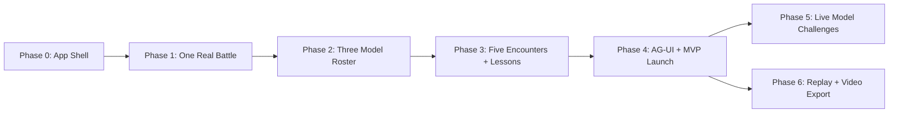

# Pokaimon: Phased Implementation Plan

**Document:** docs/IMPLEMENTATION_PLAN.md  
**Status:** Phases 0–4 implemented, CI verified. GitHub Pages deployment completed successfully (https://github.com/Danejw/Pokaimon/actions/runs/44680949777); physical Android playtest remains outstanding. See [MVP Status](./MVP_STATUS.md).  
**Baseline date:** 2026-11-19  
**Product contract:** [Game Design Document](./GAME_DESIGN.md)

**Post-MVP visual interaction revision:** The [retro battle direction](RETRO_BATTLE_DIRECTION.md) has been implemented in [PR #1](https://github.com/Danejw/Pokaimon/pull/1), CI verified, and merged. The originally planned encounter picker was removed in favor of random wild encounters and in-battle model selection. Older phase checkboxes below are historical plans; use the actual code and [MVP Status](MVP_STATUS.md) for verified implementation.

## 1. Goal and execution strategy

Ship a **real, playable, mobile-friendly AI-literacy battle game** in small complete vertical slices. Each phase adds something a player can use from start to finish, not just an isolated architecture layer.

MVP target: **3 model characters, 4 capability moves per model, 5 distinct encounters, real turn rules, game feedback, local progress, and an AG-UI-compliant interaction boundary**. Battles are intentionally deterministic **simulations**, labeled as such. No paid AI invocation is required for MVP.

**Principle:** Verify the current repository state, write failing tests for that phase, implement only what makes the tests and experience pass, run manual mobile checks, then mark phase complete. Keep unbuilt ideas out of production code.

## 2. Repository baseline and constraints

As checked on 2026-11-19, the repository was empty when these docs were first added. There is no existing implementation to preserve.

- Stack proposed: TypeScript, Vite, React, Phaser 4, Vitest, Playwright.
- Use a single deployable web application initially. A separate server is added only for the actual AG-UI streaming boundary.
- Battle rules are framework-independent TypeScript, with seeded deterministic outcomes and pure state transitions.
- Content definitions (characters, moves, encounters) are validated and versioned, not scattered through UI components.
- Do not put provider credentials in the browser.
- Distinguish playable game simulations from real inference or actual work execution.
- Use original art/music/UI; product logos and model names require appropriate attribution and use review.
- Every phase delivers a **working user path** with real local behavior, no inert buttons or placeholder “success” screens.
- Implement AG-UI as a standards boundary for connected interactions; AG-UI does not replace provider-specific adapters.

### Suggested initial directory layout

```text
docs/
  README.md
  GAME_DESIGN.md
  IMPLEMENTATION_PLAN.md
src/
  app/                 # React routes, panels, settings
  game/                # Phaser scenes, sprites, animation mapping
  battle/              # Domain types, reducer, rules, event log
  content/             # Model, move, encounter definitions + schemas
  integrations/agui/   # Protocol client and event-to-view mapper
  storage/             # Versioned local progress
  assets/              # Original art/audio
tests/
  unit/
  integration/
  e2e/
```

Start with the smallest practical structure; split modules only as boundaries become useful.

## 3. Roadmap at a glance

| Phase | Playable milestone | Est. focused days | Entry requirement | Exit gate |
| --- | --- | ---: | --- | --- |
| 0 | App boots and game stage renders | 1–2 | Empty repo | Deployed shell + CI + touch navigation |
| 1 | **One complete TASK battle** | 4–6 | Phase 0 | One character, four moves, win/lose/retry |
| 2 | **Choose between 3 models** | 3–5 | Phase 1 | 3 sprites, 12 loadout slots, feasible battle per model |
| 3 | **Five encounters + learning loop** | 5–7 | Phase 2 | Five distinct objectives, lessons, save/retry |
| 4 | **AG-UI-ready MVP launch** | 3–5 | Phase 3 | Real protocol transport, responsive QA, release |
| **MVP** | **Public playable Pokaimon** | **16–25 days** | Phase gates all passed | Go/no-go checklist below |
| 5 (later) | Live model-backed challenges | 5–10+ | MVP + API access | Verified external outcomes, consent and cost gates |
| 6 (later) | Shareable replays and videos | 4–7 | MVP replay log | Deterministic reproducible MP4/replay |

Estimates are planning ranges for a focused solo developer using AI tooling, **not promises or calendar deadlines**. Asset creation, feedback iterations, or deployment issues can extend them. At roughly five focused workdays per week, MVP is an estimated **3–5 weeks**. The recommended first review point is the end of Phase 1.

### Dependency map



## 4. Global test-first workflow

For **each phase**:

1. Inspect the main branch, dependencies, prior docs, and recent CI results. Reconcile any change before work.
2. Add or update acceptance tests for the intended user story. Record expected behavior and failure states.
3. Implement the smallest working vertical path, including visuals, rules, input, state, and user feedback.
4. Run typecheck, unit tests, integration tests, build, and E2E checks.
5. Manually play through on mobile portrait and desktop, including errors and retries.
6. Record what passed, what is unverified, screenshots or videos where useful, and unresolved issues.
7. Update phase checkboxes and any design decisions. Do not declare completion based solely on a successful build.

No silent test skipping, no unchecked mocked provider results presented as live, and no unreviewed changes to core battle math.

### Standard verification commands (once scripts exist)

- **Lint/typecheck:** npm run lint and npm run typecheck.
- **Unit/integration:** npm run test.
- **Browser E2E:** npm run test:e2e.
- **Build:** npm run build.

Prefer project scripts as the single execution interface, and document any deviation in the repo once initialized.

## 5. Phase 0: Working app foundation

**User story:** “I can open Pokaimon on my phone, see the battle stage, and navigate its real menus.”

**Deliverable:** A deployed app shell with original temporary *production-usable* geometric or pixel assets (not scraped franchise assets), responsive battle viewport, home screen, play/navigation flow, and settings that actually work.

**Tasks**
- [ ] Initialize Vite + React + TypeScript + Phaser 4, using current compatible official templates and pinned lockfile.
- [ ] Create a minimal shared app shell and Phaser scene lifecycle; clean mounting/unmounting with no duplicate game instances.
- [ ] Define domain and content schema boundaries; do not implement the full battle engine yet.
- [ ] Establish home, battle loading, settings, and “back home” navigation.
- [ ] Implement sound toggle and reduced-motion toggle, persisted locally.
- [ ] Add ESLint, typecheck, Vitest, Playwright, basic CI, and a static hosting/deployment target.
- [ ] Document dev setup, build, and deployment commands in root README when the app is created.

**Tests to write first**
- Launch renders the home page and starts the game stage without console exceptions.
- Play -> battle screen -> Back -> home works on pointer and keyboard.
- Scene is not duplicated after repeated navigation.
- Mobile viewports (360x800, 390x844) do not clip essential controls; desktop still renders.
- Settings survive reload.

**Manual demonstration:** Open hosted app on Android, press Play, open settings, mute, return home, refresh. All actions work.

**Exit criteria:** All tests pass, hosted link opens on phone, no cropped controls or console errors. No fake battle victory in this phase.

## 6. Phase 1: First complete TASK battle

**User story:** “I select GPT-6.2 Astra, face TASK, choose among four real AI technique names, and finish a battle with a meaningful explanation.”

**Deliverable:** One end-to-end encounter with an original enemy sprite, a playable model character, functioning turn engine, four moves, enemy response, budget, victory, defeat, retry, and a clear **Simulated Battle** label.

**Playable scenario:** First TASK is a simple *software-workflow task* so Diagnose -> Execute -> Verify makes sense. Explicitly explain this context to the player rather than implying every TASK is code.

**Tasks**
- [ ] Define validated ModelDefinition, MoveDefinition, EncounterDefinition, BattleState, and BattleEvent types.
- [ ] Implement pure deterministic reducer and seeded progression; UI/animations cannot modify authoritative game outcomes.
- [ ] Define TASK stages: understand/plan, do work, verify completion.
- [ ] Add one initial model loadout (Deep Think, Deep Research, Code Execution, Self-Correction). In simulation, Code Execution represents an execution-stage strategy; it does not run code.
- [ ] Add 2 × 2 move UI with focus and touch controls, AP/turn counters, stage progress, typewriter text, visible response to every move.
- [ ] Define turn-consuming enemy actions such as Scope Shift with clear visual and text effects.
- [ ] Implement win, defeat, retry, and educational feedback for weak/mismatched moves.
- [ ] Wire event log to animation cues: encounter entrance, selection, impact, progress drain, resolution.

**Tests to write first**
- Same content + action sequence + seed produces the same event log and result.
- Invalid action, unknown move, insufficient AP, or move during animation gate does not corrupt state.
- Deep Think advances planning, but cannot alone clear execution or verification.
- Missing move prerequisites produce zero/limited progress and a helpful explanation.
- Enemy action occurs once per resolved player turn.
- Clear all mandatory stages -> victory; exhaust AP/turns -> defeat; retry resets cleanly.
- One deliberately inefficient but legal sequence loses; at least one deliberate strategy wins.
- Text and status badges say “Simulated Battle”; no real model execution claims.

**Manual demonstration:** From first launch to encounter to win in one session; replay with poor move order and lose; retry without refreshing.

**Exit criteria:** A complete and enjoyable loop, with no inert moves, reproducible outcomes, and successful phone test. This is the first **playable vertical slice**.

## 7. Phase 2: Three-model selection and reusable move library

**User story:** “I can pick one of three distinct AI model characters, understand their four moves, and see how their tactics change the same encounter.”

**Deliverable:** GPT-6.2 Astra, Grok 4.7, and Claude Fable 5.2 as original playable sprites with separate loadouts and honest capability descriptions. Total **12 equipped slots**, with moves deduplicated in the registry.

**Tasks**
- [ ] Add versioned source-backed model records and a reusable move registry with stage tags and prerequisites.
- [ ] Add model selection/cards, original sprite assets, idle/entrance/attack/reaction animations, and a brief capability explanation.
- [ ] Configure different tactics/loadouts per character while retaining viable solutions to the tutorial for all three.
- [ ] Add an at-a-glance move tooltip: effective against, prerequisites, AP cost, and concise real-world lesson.
- [ ] Clearly label fictional balance stats and dated, cited vendor claims.
- [ ] Make adding a new character a content-only path; remove hardcoded references to the starting three from the reducer.

**Tests to write first**
- All 3 model definitions validate and reference exactly 4 valid move IDs.
- Every move animation ID, lesson, stage tag, and dependency resolves.
- Model version and source metadata are present.
- All 3 models have at least one verified feasible tutorial path, ideally checked by a deterministic state-space search test.
- Different loadouts create observable gameplay choices without asserting invented real rankings.
- Switching model before battle changes loadout; no switch mid-turn; UI reuses the same battle engine.
- Mobile model selection remains readable and playable by touch.

**Manual demonstration:** Win TASK with each model using strategically distinct sequences; show a wrong move explanation.

**Exit criteria:** All character paths work, no duplicated battle logic, model records are data-driven, and feasibility checks pass.

## 8. Phase 3: Five encounters, onboarding, and progression

**User story:** “I can play a set of increasingly interesting problems, learn from my choices, and continue where I left off.”

**Deliverable:** Five complete encounters: TASK, BUG, RESEARCH REQUEST, MATH PROBLEM, and HALLUCINATION; a quick guided first battle; lessons and Field Guide; local saved progress.

**Tasks**
- [ ] Implement unique objective stages, resistance/requirement patterns, enemy responses, and win conditions for all 5 encounters.
- [ ] Add progression/unlocking rules and an encounter picker.
- [ ] Show a concise post-battle explanation (chosen moves, wasted actions, why stage requirements mattered).
- [ ] Add a Field Guide of discovered models, moves, and enemies, with references to trusted sources when relevant.
- [ ] Persist only lightweight preferences, unlocks, and completed encounter IDs in versioned local storage.
- [ ] Add first-play tutorial hints, retry/skip-help paths, and basic responsive/audio/accessibility polish.
- [ ] Balance difficulty using observed playthroughs and deterministic test runs; document adjusted numbers.

**Tests to write first**
- Every encounter has a valid goal, unique mechanic, victory path, and defeat path.
- All unlockable encounters can be cleared with at least one allowed character/loadout and an attainable budget.
- Impossible content definitions fail validation before release.
- Poor move order can cause failure but explains why.
- Post-battle lessons match actual recorded events; no generic false claims.
- Progress saves and reloads; corrupted or old local save fails safely with recovery.
- Tutorial completes with keyboard and touch; completed encounters can be replayed.

**Manual demonstration:** New player completes tutorial, wins at least two other encounter types, opens Field Guide, refreshes, and resumes progress.

**Exit criteria:** Five playable problems with different solutions; progress and feedback work reliably without login.

## 9. Phase 4: AG-UI standard boundary, QA, MVP release

**User story:** “I can play reliably on my phone today; the game is ready to connect any supported model through a consistent protocol later.”

**Deliverable:** Stable public MVP with **AG-UI protocol compatibility proven by real endpoint/event tests**, even though all shipped battles are still explicitly simulation-based.

**Tasks**
- [ ] Implement a minimal server-side AG-UI stream endpoint using the official SDK and schemas, or an officially compliant reference transport.
- [ ] Create frontend AG-UI client boundary and event mapper, isolated from the reducer and Phaser scene.
- [ ] Prove event ordering: RUN_STARTED -> optional text/state/tool events -> RUN_FINISHED or RUN_ERROR; test interrupted/error streams.
- [ ] Emit honest simulation-mode run metadata when replaying scenario output through this endpoint. Do not pretend a provider was called.
- [ ] Define provider adapter contract for future OpenAI/xAI/Anthropic services (model ID, capabilities, tool eligibility, streaming result, usage, error, cancellation).
- [ ] Keep the client secret-free, with strict payload validation, timeouts, and appropriate request size limits.
- [ ] Build CI gates, smoke-test deployed site, accessibility checks, mobile touch QA, and clear failure UI.
- [ ] Audit original assets, name/brand usage, vendor credits, and privacy notices before promotion.
- [ ] Tag the first release only after go/no-go passes.

**Tests to write first**
- Genuine AG-UI client can parse the endpoint's ordered lifecycle/text/state events.
- Unknown/out-of-order or malformed events are rejected or handled safely.
- Interrupted stream and RUN_ERROR leave the UI usable, no phantom victories.
- Provider adapter interface can add a fourth model definition without changing reducer or Phaser UI.
- All 5 encounters complete from fresh session on mobile; keyboard and reduced-motion paths pass.
- No provider keys, hidden paid calls, or fabricated results appear in network traces.
- Accessibility smoke: labels, focus, non-color feedback, and no keyboard traps.
- CI gates lint, typecheck, tests, E2E, and build.

**Manual demonstration:** Load deployed site on Android; play a full encounter; restart the tab; verify progress; inspect a successful AG-UI test stream and a deliberate error case; play a second encounter in reduced-motion mode.

**Exit criteria:** MVP go/no-go below is all green. Mark release with a version tag, site URL, verified test results, and known limitations.

## 10. MVP release gate

- [ ] Three playable model characters; four legitimate moves per loadout.
- [ ] Five distinct battle encounters with stage-specific goals.
- [ ] A new player can win, lose, retry, and understand why without reading developer docs.
- [ ] No progress by spamming one move past missing prerequisites.
- [ ] Battle state is deterministic, versioned, and separate from rendering.
- [ ] Source-backed model/capability descriptions and visible simulated-game distinction.
- [ ] AG-UI transport and error-handling conformance tests pass.
- [ ] No real provider billing or access to personal data in MVP.
- [ ] Phone touch/portrait, desktop keyboard, mute, and reduced motion are tested.
- [ ] CI green, deploy green, original-asset and attribution audit complete.
- [ ] Docs agree with the code and known limitations are clearly stated.

**Go:** All critical checks pass. **No-go:** A false “real AI executed” claim, broken battle logic, inaccessible critical controls, missing AG-UI conformance, accidental API-key disclosure, or unlicensed copied assets.

## 11. Phase 5 (post-MVP): Connected model challenges

**User story:** “With explicit permission, I can spend a known amount to have a selected model actually attempt a limited real task and inspect verified results.”

This phase is **optional and separate** from shipping the game.

**Deliverable:** First narrowly scoped live challenge using one provider, with a reproducible evaluation fixture, truthful evidence, and no autonomous persistent computer infrastructure.

**Tasks**
- [ ] Design a safe evaluation task with bounded input/output and independent success criteria.
- [ ] Add one production provider adapter server-side, then broaden to the other two.
- [ ] Expose explicit model availability, supported tools, price estimate, budget cap, cancel, and failure modes.
- [ ] Stream lifecycle and output through AG-UI; retain a correlation ID, usage, and verification evidence.
- [ ] Run actual tools only when explicit task grants permit it; sandbox code or search as appropriate.
- [ ] Map evaluated real outcomes to battle effects; separate model result quality from artistic battle animation.
- [ ] Add abuse controls, redaction, retention policy, error reporting, and billing transparency.

**Tests:** Correct model/version selected, capability unavailable correctly disabled, no unauthorized tool call, rate-limit and timeout handled, cancellation stops spend as far as provider supports, outcome based on verifier, audit identifies total actual cost, no victory on mere fluent text.

**Exit:** At least one genuine, end-to-end task run with independent pass/fail verification and a disclosed cost. Provider expansion occurs one adapter at a time.

## 12. Phase 6 (post-MVP): Replay and content sharing

**User story:** “I can replay or export my best battle as a short, vertical meme-worthy video.”

**Deliverable:** Replay viewer and eventually 15-second portrait MP4 export generated from the game's authoritative event log and original audiovisual assets.

**Tasks**
- [ ] Save battle seed, content versions, and ordered replay actions/events.
- [ ] Reconstruct battles deterministically, with scrub/replay controls.
- [ ] Add original audio cue timing and fixed animation timeline.
- [ ] Build image/video output pipeline only after faithful in-app replay is stable.
- [ ] Add concise attribution and “simulated” indicator to share output.

**Tests:** Same log yields same states/frame sequences, text and audio cues stay in sync, all current moves/encounters replay, portrait title-safe area holds, audio is present in MP4 and absent in GIF, exported content does not claim live execution.

## 13. Acceptance test matrix

| Area | Unit/integration | E2E/manual |
| --- | --- | --- |
| Battle legality | Reducer rejects invalid actions; budget and prerequisites enforced | Wrong move explains failure; retry works |
| Determinism | Same seed + inputs -> same states/event log | Replay equivalent after refresh |
| Content integrity | Schema, IDs, references, solvability | Characters/encounters render without missing assets |
| Educational claims | Mandatory source/status metadata | Lesson matches what happened |
| AG-UI | Valid event order, cancellation, malformed stream handling | Connected stream/error shown safely |
| Responsive UI | Viewport calculations, settings persistence | Android portrait and desktop keyboard/touch |
| Accessibility | Labels, state announcements where testable | Reduced motion, focus, readable type, mute |
| Security | No secrets client-side, server schema enforcement | Inspect deployed assets and network requests |

## 14. Release cadence and reporting template

Track each phase with the same concise report:

```text
Phase:
Goal / user story:
Changed files / commit or PR:
What is actually playable:
Automated tests (pass/fail, command, run):
Manual Android / desktop checks:
Evidence (screenshots, deployment URL, logs):
Known issues / unverified claims:
Go / No-go:
Next smallest vertical slice:
```

Only mark checkboxes complete after verified implementation. If a phase slips, keep scope stable and re-estimate from evidence rather than inflating future phases to compensate.

## 15. Risks and mitigation

| Risk | Mitigation |
| --- | --- |
| Educational fiction mistaken for real model performance | Label simulation, cite model capabilities, avoid unsourced comparisons |
| Inability to clear an encounter with a given loadout | Static content validation + automated solvability search |
| State desync between Phaser/React/AG-UI | One authoritative domain reducer; renderers subscribe to committed events |
| Scope explosion toward agent operating systems | Keep real execution post-MVP; no persistent computers or orchestration |
| Bad mobile text/controls | Portrait-first design, specific device viewport tests |
| Intellectual property similarity | Original creatures, trainers, audio, UI, and branding clearance |
| Model names/versions change | Source-dated registry, separate provider adapter IDs |
| High token costs | Zero paid provider calls in MVP; hard caps and consent later |
| AG-UI complexity | Validate minimal standards endpoint with conformance tests before real inference |

## 16. Immediate next action

Begin **Phase 0** in the empty repository. Do not start the model-provider adapters, multiplayer, cloud persistence, or video generation yet.

The first work request to a coding agent should be: *“Set up the minimal Pokaimon React/TypeScript/Phaser web app with a phone-friendly battle stage, real navigation and settings, baseline tests, CI, and a working deploy preview. Follow the docs; stop at Phase 0's acceptance criteria and report evidence.”*

After Phase 0, implement the **TASK** battle as the first true vertical slice and review how fun and educational it feels before adding more systems.
