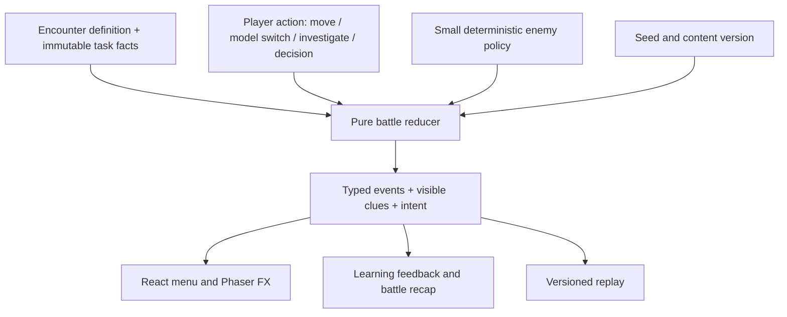

# Phase 6: Battle Intelligence 2.0

**Status: planned, not implemented.** Execute after the existing Battle Evolution branch is stable. Phase 8 follows Phase 6; Phase 7 (Gauntlet) is deliberately deferred. No overworld, network AI, model execution or new backend.

## 0. Purpose and playable promise

Transform the existing capability-to-stage battle into a **decision-driven, reactive, explorable problem**. The player observes evidence, forms a hypothesis, chooses an approach, responds to the enemy's actual behavior and can win through **multiple legitimate strategies**. A wrong move changes the situation or reveals useful information; it should rarely be a silent "wrong type" button.

Three deliberately deep signature encounters are the release scope. Do not add 30 shallow battles or build an open-ended simulation framework.

**Reference implementation, November 20, 2026:** `src/battle/engine.ts` is a deterministic reducer with six AP, eight turns by default, three stages, stage category matching, a turn-two enemy special, a guard, Research → Verification combo, model switching consuming one turn but zero AP, a scripted rival penalty and a one-time boss phase effect. `src/battle/types.ts` has `BattleState`, `BattleEvent`, `EncounterDefinition`, and `StageDefinition`. `src/content/encounters.ts` contains five base encounters; `src/content/campaign.ts` provides nine scripted missions. `src/content/variants.ts` creates seeded modifiers; `src/battle/replay.ts` restores deterministic event history. The presentation is React + Phaser with Easy/Medium/Hard information-disclosure settings. Keep these contracts working.

## 1. Design pillars

1. **Observe → decide → act → adapt.** The enemy exposes enough cues for a player to reason. Some information is discoverable and some is initially uncertain. Uncertainty is not an arbitrary dice roll.
2. **Consequences are causal and legible.** Each interesting move changes task state, clues, enemy intent, risk, resources or progress. The battle log says why; animation shows the same event.
3. **Multiple viable strategies.** A signature encounter must have at least two demonstrably different winnable action sequences, preferably using different models/techniques. Solving the puzzle should feel earned, not mandatory memorization.
4. **Enemy intelligence from systems, not fake LLM improvisation.** A small deterministic policy reacts to evidence, player repetition, attempted shortcuts, and stage outcomes. Same scenario seed + action sequence = same result.
5. **Real AI literacy.** Research, debugging, decomposition and verification mechanics map to actual best practices, but battle outcomes are marked *simulated*. A fictional boss strategy is never represented as a claim about model providers.
6. **Maintain the existing game.** All original five wild encounters, nine campaign missions, teams, stored progress, challenge codes, replays, settings and optional AG-UI interface must remain compatible. Do not alter prior recorded result semantics silently.

## 2. Concrete playthroughs and signature encounters

### Encounter A: Hallucination Hydra (evidence and epistemic confidence)

The boss presents a confident claim. Three possible evidence leads exist, some mutually dependent. Each unverified acceptance gives the Hydra a new "head" (one of a bounded set of credibility traps); blindly repeating Research accumulates sources but cannot establish independent corroboration.

Player strategies:
- **Investigate carefully:** question a claim → retrieve independent evidence → compare provenance → verify a conclusion.
- **Recover from a mistake:** accept a tempting but unreliable claim → observe a contradiction → use a correction/verification move to retract the claim → find corroboration.

Game state: claims `unexamined / questioned / supported / contradicted`, `independentSourceCount` (bounded), `falseConfidence` (0–2), `headCount` (0–3), available clues, and announced next enemy action. Independence is authored data, not inferred by raw source text.

Example enemy responses: **Echo Chamber** adds a duplicate source when the player repeats retrieval; **Confident Claim** raises false confidence if verification was skipped; **Contradiction Revealed** exposes a previously hidden weakness after appropriate cross-checking.

Lesson: repeating or increasing fluent claims does not establish evidence quality. The encounter never retrieves real articles.

### Encounter B: Regression Golem (debugging and testing)

The boss guards a broken application with two plausible fault hypotheses. A rushed patch may yield temporary simulated progress but create a hidden regression; targeted diagnosis and tests can reveal the root cause.

Strategies:
- **Methodical:** inspect symptom → test hypothesis → patch confirmed defect → run independent regression check.
- **Risky but recoverable:** apply provisional patch → observe failing test/reopened requirement → diagnose → correct → verify.

Game state: fault hypothesis, `patchStatus`, `testCoverage`, `regressionRisk`, `rootCauseKnown`, blocked/unblocked action prerequisites, and golem's next stance.

Enemy responses: **Moving Target** updates a requirement with a clear telegraph; **Regression Slam** reopens only a known affected stage; **Brittle Patch** penalizes unchecked fixes but allows recovery.

Lesson: a plausible patch is not proof of success; reproduce, fix and test. No real code is edited or executed.

### Encounter C: Scope Shifter (planning under changing constraints)

The enemy changes a stakeholder requirement after the player commits to a plan. Alternative approaches trade cost, speed and verification risk; discovering constraints in advance can prevent rework.

Strategies:
- **Clarify early:** ask questions and preserve resource budget; then choose the right implementation and verify.
- **Adapt midstream:** commit an initial viable approach → receive new requirement → revise the plan and revalidate, with different cost/turn consequences.

Game state: `constraintsKnown`, `selectedApproach`, `changeBudget`, `reworkDebt`, `deliverableChecked`, future intent, and whether the player changed strategy.

Enemy responses: **Scope Creep** when plan assumptions are weak; **Deadline Pressure** when time budget is low; **Acceptance Gate** demands a final test.

Lesson: clarification, adaptability and verification are complementary.

**First playable proof** is Hallucination Hydra. Build the other two through the same minimal extensions and refine the mechanic only after actually playing the first.

## 3. Domain architecture

**Extend, do not replace, the reducer.** A narrowly typed `EncounterMechanic` or scenario-specific state union may be added to `BattleState` when 6A tests need it. Prefer a `mechanicId` referencing three authored handlers rather than an arbitrary scripting language, evaluator, rules DSL or generically interpreted actions.

Proposed concepts, subject to proof in 6A:
- `BattleAction`: discriminated union for existing `UseMove`, `SwitchModel`, and at most one new `InspectClue / ChooseApproach` command. Preserve old `applyMove` and `switchModel` exports as adapters during migration.
- `ScenarioFacts`: immutable scenario seed, clue graph, stage objectives, alternative solution tags, enemy policy ID, and disclosure rules. A clue has a stable ID and an authored true/false/uncertain role.
- `ScenarioState`: compact per-encounter variables, available clues, last action, pending enemy intent, known hypotheses and resolved objectives. Hard limits on counters, statuses and branching.
- `EnemyIntent`: `kind`, trigger condition, target, public cue, resolveAfter, deterministic priority; announce before action whenever reaction is possible. No hidden undodgeable turn-two punishment in new encounters.
- `BattleEvent`: add only used event kinds (`CLUE_FOUND`, `HYPOTHESIS_TESTED`, `ENEMY_INTENT_REVEALED`, `APPROACH_CHANGED`, `CONSEQUENCE_RESOLVED`) with typed payload fields. Do not parse event message strings for rules or achievement logic.
- `ActionResult`: whether an action is legal, its AP/turn cost, changed facts, changed objectives, messages and FX. Illegal actions must not consume a turn or mutate state. Avoid duplicated progress calculation in UI.
- **Versioned replay:** scenario ID + rules/content version + seed + player actions + final digest. Old PK1 challenge codes and replay format must continue to load through their original adapters; introduce a version only when required.

**Important mechanic choices to validate:** What counts as a meaningful "inspect" action? If it is free and infinitely repeatable, it becomes a spammed hint button; if it costs a turn, it must reveal something worth the trade. Start with one investigatory action costing one turn and no AP, then tune through battle reachability rather than prematurely adding two currencies.

## 4. Serial vertical slices

### 6A. A clue that changes a real decision

Implement **one** Hallucination Hydra clue and two selectable tactical responses in the current fixed battlefield. Show the enemy's claim, one discoverable contradiction, and a succinct clue notebook available during battle. Both actions change reducer state, and their feedback explains the difference.

Touchpoints: `src/battle/types.ts`, `src/battle/engine.ts` (or small `src/battle/mechanics.ts`), new authored `src/content/intelligentEncounters.ts`, `src/game/BattlePanel.tsx`, `src/game/BattleStage.tsx`, reducer/Playwright tests.

Tests before implementation: legal inspect produces exactly one clue event and deterministic state; duplicate inspect cannot farm knowledge or AP; invalid clue IDs do nothing; visible UI choice works at phone size and by keyboard; old TASK encounter still wins with the same sequence.

Acceptance: player can explain the clue and use it on the next turn; both the shortcut and careful response produce distinct visible consequences.

### 6B. Explicit enemy intent and real counterplay

Add one telegraphed Hydra reaction policy that considers the previous *meaningful* action, not just a turn counter. Allow at least one reasonable defensive response via verification, switching or investigation. Consume/clear intent exactly once.

Tests: deterministic policy transitions, blocked vs unblocked attack, no unannounced irreversible failure, status expiry, reduced-motion visible text, Easy/Medium/Hard disclosure affecting information not math.

Acceptance: the player can correctly predict at least one threat and intentionally defend.

### 6C. Alternative routes, recovery and solvability

Build the Hydra's complete multi-stage scenario with two distinctly different successful action traces and one failure/recovery trace. Add a bounded state-space explorer for all approved starter squads and representative seeds, considering resource limits and conditional enemy behavior.

Tests: two wins with distinguishable model/move or clue sequences; recovery from one mistake; explicit test for genuinely losing sequence; no unwinnable default roster; progression has upper bound; script never exceeds max turns/AP or creates infinite loops.

Acceptance: one Hydra battle is a complete, independently replayable challenge and the result explains why actions mattered.

### 6D. Regression Golem

Reuse 6A–6C action/events, add a hypothesis and coverage mechanic, two actionable hypotheses, a reversible faulty patch, and an enemy response to skipping tests. Introduce only the smallest missing effect handler.

Tests: false hypothesis affects outcome but remains recoverable; test events prove what was checked; repeated generic coding moves cannot brute force verification; two valid strategies; red/green playthrough; UI hint parity.

Acceptance: a player learns the difference between plausible fix and tested fix through play.

### 6E. Scope Shifter

Implement changing constraints, alternative implementation paths and a resource-aware reaction. The change should be both telegraphed and explainable. Ensure one path succeeds by clarifying early and one by adapting after change.

Tests: changed constraints invalidate only dependent work; rework is bounded; scenario is beatable through both routes; no fabricated real-project outcomes; loss message identifies avoidable decision, not vague "wrong move".

Acceptance: players have to adapt, rather than just switch a capability type.

### 6F. Game feel, learning and progression integration

Give each boss an original pixel-art silhouette, short telegraph pose and attack category cue, distinct sound when enabled, readable evidence/clue UI and a concise end-of-battle **strategy timeline**. Allow a player to compare their two attempts, e.g. "verified before patch" vs "patched without tests", without claiming an actual provider comparison.

Integrate with Wild Battle/Challenge and, if it fits campaign continuity, an optional new bonus trial rather than silently altering the already cleared nine missions. Old progress remains intact. Rewards can unlock an alternate legitimate tactic or decorative badge; avoid stat inflation that invalidates prior battles.

Tests: responsive command panel at 360×800 and 390×844, desktop 1280×720 and 1440×900; no hidden buttons; event/FX synchronization; mute, reduced motion, screen-reader announcements; replay before/after migration; persistence; first-time and returning user navigation.

### 6G. Balancing and final release gate

Create a **scenario-matrix harness** that tests all three authored enemies with default three-slot team, at least two alternate rosters, 3 seeds each, ordinary and challenge budgets, Easy/Medium/Hard disclosure, victory/recovery/defeat. Verify that choices are meaningful: no universally optimal first two actions across all three battles; a poor move costs something but does not always immediately hard-lock the run.

Playtest each full encounter in browser, inspect actual mobile/desktop screenshots and short animation recordings, then tune one budget/mechanic at a time. Record exact tests, screenshot paths, commits and tradeoffs in `NEXT_EXPANSION_TASKS.md`.

**Phase 6 complete when:** all three distinctive bosses are playable, each has at least two independently verified winnable approaches, enemy reactions respond to meaningful choices, recoverable mistakes are supported, and a new player can explain one real AI lesson after each win. Run `npm run lint`, `npm run typecheck`, `npm run test`, `npm run test:agui`, `npm run build`, `npm run test:e2e`; no regression on old encounters, campaign, rewards, saves or replays.

## 5. Non-goals, risks and fallback

- No walking map, Gauntlet, PvP, text-input LLM adversary, arbitrary user-provided code, paid inference, invented real research results, random unsolvable fights or large general-purpose rules engine.
- Risk: too many mechanics confuse new players. **Fallback:** one novel mechanic per boss, progressively disclosed.
- Risk: forced move answers make battles rote. **Fallback:** compare different valid routes, reduce exact numeric hints on Medium/Hard, keep feedback truthful.
- Risk: variable enemy behavior breaks replay. **Fallback:** pure seeded policy and typed event traces with content version.
- Risk: long battles overwhelm phone. **Fallback:** compact clue overlay and explicit advance/skip animations, never hide essential controls.

## 6. Phase handoff to Phase 8

Phase 8 may attach automatically imported, independently sourced new models and evolutions to these same battle scenarios through the **existing move registry and a conservative role/loadout mapping**. Enemy behavior must not have hardcoded provider or model IDs. A new creature should work without any scenario-specific code branch.

This document is an implementation specification. Its mechanics are proposals until accepted by failing-first tests and actual play. Do not mark Phase 6 completed based on document creation.
