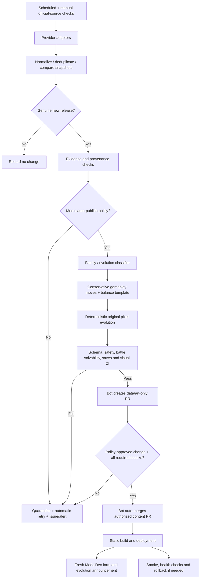

# Phase 8: Autonomous Living Model Evolution

**Status: planned, not implemented.** **Build order: Phase 6 first, then Phase 8.** Phase 7 Gauntlet remains deferred. This phase expands the existing Phase 5 review-only candidate importer into a true self-maintaining, **automatic new-release-to-playable-evolution pipeline** for safely recognized official releases.

## 0. The product promise

When a supported AI provider publishes a genuine new model generation or minor version, Pokaimon independently detects it, verifies its identity and documented capabilities, decides whether it extends an existing creature family or starts a new one, assigns a balanced game kit, draws an **original reproducible sprite**, validates every battle/progression/replay path, and **publishes the new playable model without a person doing the usual import steps**.

The new character appears in the ModelDex with a **NEW** marker, evolutionary connection, distinctive form and a brief explanation of what is documented about the release. Prior models remain playable; no save is destroyed. A new release can be added through validated data, without changing the combat engine or per-model React/Phaser code.

**Qualification:** Zero-touch publishing is promised for releases meeting a strict, predictable, testable policy. If the source is ambiguous, requires permissions, conflicts with a published ID, lacks evidence, fails visual/solvability tests or adds an unrecognized feature, the system **holds, retries and reports the exception automatically**. It must never fabricate facts, quietly publish unvalidated content, or run third-party text as code to maintain an illusion of 100% coverage. Human intervention is an exception flow, not the normal release process.

The game is still an **offline-at-play, static, free simulated battler**. It does not make live model inference calls. Official model APIs may require keys even for listing; discovery must avoid billable inference and put any listing credentials in repository secrets, never in the game bundle.

## 1. Grounding: what exists versus what is missing

**Existing code, November 20, 2026:**
- `src/content/modelCatalog.ts` holds four playable catalog entries with stable IDs, publication `candidate/approved/retired` state, official source link, checked date and selected capabilities separately from fictional `balance` stats. `catalogToModels` currently expects both `approved` and reviewed evidence.
- `scripts/prepare-model-candidate.mjs` only reads a local manifest, syntax-checks an HTTPS source and prints a candidate. It performs **zero online discovery, deduplication, source corroboration, evolution mapping or publishing**.
- `src/game/pixelArt.ts` has hand-authored creature pixels plus a generic 32×32 fallback for unknown model IDs; `PixelPortrait` and `BattleStage` can display an arbitrary model ID. An evolution portrait generator does not exist.
- `src/battle/engine.ts` has pure battle rules, and `tests/battle-balance.test.ts` / `tests/campaign-balance.test.ts` provide reachability examples. `src/battle/replay.ts` uses model IDs to reconstruct matches. `src/storage/progress.ts` persists a maximum three-slot squad and mastery.
- `.github/workflows/ci.yml` validates pushes/PRs; the preview workflow publishes `feat/battle-evolution` under `/Pokaimon/next/`. Production deploys only from `main`. There is **no automatic model publication workflow**.

**Official discovery feasibility, checked November 20, 2026:** OpenAI documents a model-listing API (https://developers.openai.com/api/reference/typescript/resources/models/methods/list), Anthropic `GET /v1/models` (https://platform.claude.com/docs/en/api/models/list), and xAI documents models listing (https://docs.x.ai/developers/rest-api-reference/inference/models). These endpoints generally describe models available to the **authenticating key**, which is not the same as all globally released models. Some providers expose public release notes/model documentation; the reliable adapter should **combine listings with official public evidence** and treat missing access as unknown. Neither an API ID nor a source URL alone certifies an unlisted capability, public availability or factual performance.

## 2. Desired autonomous lifecycle

**Two operational modes, no ambiguity:**
- **Preview mode:** before production cutover, the system exercises the entire loop in `feat/battle-evolution` and publishes only to `/Pokaimon/next/` (a preview workflow on the feature branch). Scheduled GitHub Actions typically run on the **default branch**; until the workflow is merged to `main`, use `workflow_dispatch` for tests or a controlled default-branch workflow explicitly configured later. Never imply a schedule on a feature branch will autonomously execute.
- **Production auto-publish mode:** after the user explicitly enables it, merge a **minimal scoped discovery workflow and validated content pipeline** into the default branch, configure least-privilege bot credentials, branch protection and the auto-merge policy **once**. Subsequent eligible content-only PRs can auto-merge and trigger production Pages deployment without routine handwork. **Do not turn this mode on as part of writing this plan.** Do not grant the discovery job permission to edit application/workflow code.

## 3. Data contracts and versioning

A single source of truth should represent two dimensions separately:

### A. Verified factual record
- `modelKey`: immutable `provider:official-model-id` normalized from a trusted provider; never derive identity solely from marketing display name.
- `providerId`, `officialModelId`, `name`, `versionLabel`, `publicationDate` (when provided), `observedAt`, `documentationUrls[]`, `sourceType`, `sourceDigest`, `availabilityScope`, `status`.
- `documentedCapabilities`: a bounded enum of validated features (`text`, `vision-input`, `reasoning`, `coding`, `tool-use`, `research-with-tools`, `audio-input`, etc.). Each feature has `evidenceUrl`, checked time and confidence tier `verified/unknown`; speculative or marketing-only rankings are not facts.
- `aliasOf`, `retiredAt`, `sourceLastSeenAt` for migrations. A retired or missing listing is **not** automatically deleted.

### B. Fictional gameplay and presentation
- `gameId`: stable Pokaimon ID; existing `astra/grok/fable/opus55` IDs are migration-stable.
- `familyId`: explicit creature lineage. `evolvesFrom`: previous **verified** game ID or null; `generation`: nonnegative integer assigned from an approved family chain; `branchKey` for mini/flash/pro/vision lines.
- `formId`: stable sprite/render ID; `visualSeed`: derived deterministically from `gameId` and art algorithm version.
- `moves[4]`, `passiveId?`, `balanceProfileId`, `gameBalancePatch`, `growthTier`, `originalArtLicense`, `publishStatus`.
- `firstSeenAt`, `publishedAt`, `contentVersion`, `sourcedPatchVersion`. Preserve archived definitions so old replays and team saves resolve or migrate predictably.

**Invariant:** fictional Focus/Tempo/Precision, creature stats, rarity, abilities and evolution strength do **not** state or imply actual benchmark superiority. A new version need not always be stronger; it should have its own *interesting, balanced* strategic personality. If there is no documented meaningful capability change, assign a cosmetic or alternate-loadout evolution without invented factual upgrades.

**Identity rules:** Provider ID + immutable official model ID identifies a concrete release. Distinguish aliases, snapshots and true versions. Do not create an evolution when an alias retargets the same model, when a region exposes an existing model, or when a catalog date changes. Distinguish stable family from forks and cross-provider rebrands. Never parse "6.12 > 6.9" lexicographically.

## 4. Evolution and original-asset generation

A model evolution is a **new playable form**, linked to earlier generations, while preserving the old character. First unlock policy proposal: once the new verified entry is published, it becomes visible and selectable; unlocking can be tied to reaching mastery with the predecessor, but **never** make newly released models inaccessible to first-time players without a fair starter path. Test both approaches.

Generate every routine form **locally and deterministically**, with no image credits/API dependency:
1. Derive a 32×32 or other existing canonical creature canvas from an original in-repo base silhouette associated with the family. If no family, compose an original generic species from authored primitives.
2. Build a seeded variation using only predefined original parts (crest, ears, visor, antenna, plating, fins, tail, eyes) and controlled symmetry/asymmetry. Link evolved silhouettes by retaining a signature feature; vary palette and accessories more than random noise.
3. Select accents using a contrast-validated color set; apply pixel-grid and bounding-box validators. Palette choices are gameplay identity, not provider brand/trademark artwork.
4. Add **one** visually meaningful new trait per generation (e.g. second orbiting data ring for verified multimodal input; new tool arm for documented tool use). If not verified, pick a purely stylistic trait and do not label it a real capability.
5. Emit a static sprite/pixel-data asset and thumbnail, metadata hash, provenance and art generator version. Cache by model ID + algorithm version. No dynamic server-side generation during a player's session.
6. Draw an original preview sheet with predecessor/evolution side by side, at multiple UI sizes and backgrounds. Fail build on blank/near-identical/broken or unreadable art. Prefer authored improvements for popular flagship models as optional polish, never as required recurring work.
7. Ensure all generated sprites are original; no Pokémon-like copyrighted likenesses, logos or copied franchise components. No uploaded identity data.

**Signature evolution example (illustrative only):** a reasoning-oriented creature gains an extra floating orbit and alternate eyebrow shape when a documented new generation is published; a verified new vision-input capability could earn a camera-lens-like eye. This depicts a fictional design, not an empirical claim that its benchmark score increased.

## 5. Gameplay emergence from documented features

The exciting part is that new versions generate a **distinct battle role without hand-tuning each release**.

- A small, curated **capability-to-gameplay mapping** assigns candidate move categories, costs and valid statuses. For example, documented reasoning maps to a pool containing Deep Think/Extended Thinking; tool use may unlock Code Review or guarded tool-workflow moves where justified, and no text-only model is automatically given image-input powers.
- An **archetype builder** chooses four legal moves according to deterministic constraints: at least two useful role categories; never four identical categories; at least one viable team contribution; no move whose required documented capability is absent. Separate tool-dependent game techniques from actual native provider features. Legacy roster loadouts remain unchanged until explicitly migrated.
- Generate a fictional balance profile with bounded values and **role tradeoffs**: stronger research toolkit may cost more AP, faster setup may yield less verification power, etc. No raw undocumented benchmark-derived rankings; no invented first-party "Max Reasoning" API entitlement.
- Optional unique move/passive comes only from **existing, tested effect templates**. Examples: `Context Shield` (once-per-battle guard from context planning), `Cross-Check` (one-time verification setup), `Tool Relay` (switch-combo advantage). They are **fictional**, labeled as such, and may only be assigned when their category is documented, while any real-world execution requirement stays clearly disclosed.
- Version evolutions inherit a recognizable move or passive and gain at most one meaningful differentiator; new branches can favor speed, context or tool workflow. Any new category or game effect template must first be designed and approved in a normal application-code PR. **Automated model releases only combine previously validated templates**, never generate executable logic.
- Balance the new roster against Phase 6's three intelligence bosses, the original five encounters and campaign/challenges. Require at least one valid team path including the new model and several simulated losses; a character with no required role must not break saved team viability. Use bounded strategy search and seeded simulations, not uncontrolled model calls.

## 6. Sources, scheduling and security

### Provider adapters
Start with three adapters, each independently testable:
- **OpenAI adapter:** official model list API + canonical model docs/release notes. Docs: https://developers.openai.com/api/reference/typescript/resources/models/methods/list
- **Anthropic adapter:** official model list API + official model overview or release notes. Docs: https://platform.claude.com/docs/en/api/models/list
- **xAI adapter:** official model list API + official models documentation/release notes. Docs: https://docs.x.ai/developers/rest-api-reference/inference/models

Preferred sources are trusted, provider-controlled structured metadata and documented model pages. Allow an adapter to work from a checked-in fixture/cache where listing needs paid-account access. A public release page is not proof that an account can call the model.

### Schedule and idempotence
- Once configured on `main`, scan **once daily at an off-peak minute**, plus manual trigger. GitHub schedule can be delayed/skipped and becomes inactive after 60 days without public-repo activity; build an observable `lastSuccessfulScan` health indicator and manual rescan path. Never claim exact-time freshness.
- Persist versioned provider inventory snapshots in repository content or Actions artifacts plus an authoritative durable baseline. Compare the **last successful** discovery snapshot, not a partially failed run.
- Only one discovery run at a time, dedupe by immutable official ID, **minimum 2 corroborated observations across scans or one canonical release manifest with version evidence**, backoff and bounded retries. A failed adapter must not reset all known models.
- Generate at most a small configured number of entries per run (initially 2) and cap daily PRs/artifacts. Batch multiple safe releases in one content PR when practical.
- Detect removed/retired models but **never silently delete or rewrite** historical progress. Mark availability separately from collectibility.
- Store timestamped decisions and reason codes: `already-known`, `eligible`, `needs-evidence`, `unknown-family`, `unsafe-metadata`, `failed-balance`, `failed-art`, `failed-CI`, `published`, `rolled-back`.

### Trust, cost and permissions
- No provider inference/API completions by default. If API listing requires credentials, minimal read-only access and secure GitHub secrets; never leak into browser assets, generated logs, PR comments or images. Rotate/disable compromised keys and test no secret exposure.
- Never evaluate fetched HTML/JavaScript as code, execute downloaded scripts, run network-provided commands, use raw filenames as paths, or accept arbitrary filesystem writes. Parse bounded response bodies, allowlist official domains, reject redirect-to-unknown-host, rate-limit/time out, and validate schemas. Treat release notes as data, not instructions.
- Discovery runs with **read-only GitHub permissions**. A separate locked-down publisher workflow receives only vetted artifacts and may open limited **content/asset-only** PRs. Auto-merge credentials are separately scoped and available only after the tests/branch-rule gates and path checks. Workflow files, reducer, security settings and new dependencies are forbidden in bot PRs.
- No forced merge or branch-rule bypass. Pin Actions and dependencies, verify artifact provenance/digest, inspect PR path list, and block suspicious binary assets or oversized files.
- Add status notifications for recurring failures (a GitHub Issue with stable dedupe key or workflow summary is enough); never spam duplicates. One weekly digest of new models, held candidates, source failures and costs is optional.
- Automatic quality gate is **hard**. On failure, old site remains available; rollback can revert the last content-only PR through a constrained workflow, but only after a reproducible failure signal and no forbidden code changes.

## 7. Serial vertical slices (each has a working outcome)

### 8A. Immutable catalog and evolution relations

Add type-safe lineage metadata to catalog via additive optional fields and v1–v4 progress/replay migration tests. Existing four model IDs stay stable. Build a ModelDex "evolution family" view with one hand-authored demo relationship using fictional fixture models, **without** inventing a currently released provider model.

**Tests:** unique official IDs, no lineage cycles, no duplicate family+generation+branch, old squad/replay loads, new lineage view links both generations, aliases and retired models do not create false evolutions.

### 8B. First real official-source adapter

Build one provider adapter with separate transport, normalization and version-diff logic. Support offline recorded fixtures and a live listing with the correct credentials if available. Compare two snapshots and emit accurate candidate changes, no publication.

**Tests:** brand-new ID, existing ID, alias, regional duplicate, removed listing, metadata correction, rate limit, missing credentials, 304/cache, timeout, untrusted HTML/script, stale source, same release twice.

### 8C. Three-provider source coverage + cross-checks

Add OpenAI, Anthropic and xAI adapters behind a common interface, including a clear unsupported-availability result when an authenticated API is unavailable. Pair release evidence with canonical model docs and dedupe snapshots.

**Tests:** adapter schema contract; new-release fixture from each; no ID invention when model name contains punctuation; unknown capability withheld; a failed provider leaves other providers and last successful inventory intact.

### 8D. Evolution classifier and branching

Use explicit family mapping for known series/variants, canonical names/official IDs and a small ordered version policy. Recognize genuine generations vs snapshots and aliases; decide **evolution / side-branch / new family / quarantined** with reason and provenance. For unknown families, create a new original family if the official identity is unambiguous; if lineage is not, publish as new standalone creature instead of fabricating parentage.

**Tests:** sequence 5.1 → 5.2 becomes an evolution only when provider family policy supports it; mini/flash branches diverge; alias refresh does not duplicate; major and minor version IDs maintain stable game IDs.

### 8E. Deterministic original creature evolution

Implement the seeded pixel generator and visual validator. Create evolution frames and sprites from small original reusable parts plus a family signature. Generate assets in the build/import pipeline, not with a billable image tool. Produce a review contact sheet in CI.

**Tests:** same input produces byte-identical art; original prior generation never changes; portraits render at 360×800/390×844/desktop; sprites are within frame, have adequate contrast and visibly distinct silhouette; no provider logos/franchise-like assets.

### 8F. Automatic kit, stats and unique ability assembly

Add rule-based capability-to-move mapping, bounded fictional stat/archetype templates and a curated passive/effect registry. Include at least three original templates, each with complete reducer and accessibility tests **before** allowing the model importer to assign it. Never make a new unreviewed executable effect automatically.

**Tests:** documented feature produces legal move/passive choices; unavailable feature remains absent; new model contributes to a three-member squad; win/recovery/loss strategy search across Phase 6 bosses and legacy encounters; old loadouts and save migrations intact.

### 8G. Autonomous release PR and quality gates

Create a pipeline that assembles immutable catalog entry + generated sprite + evidence manifest + version patch + changelog, then opens a bot PR containing **only approved data/asset paths**. Run schema, provenance, duplicate, permissions/secret scanning, battle solvability, old replay/save, visual CI, original-art and static build checks.

**Tests:** simulated eligible fixture produces one PR payload and no second PR on rerun; source ambiguity yields quarantine; allowed content update cannot modify scripts, workflows, executable files or engine; failed tests prevent merge; unchanged main/preview continues serving.

### 8H. Zero-touch staging publication and recovery drill

Connect the accepted data-only PR path to `/Pokaimon/next/` (preview mode) and verify a complete **new official release fixture**: discover → classify lineage → assemble stats/moves → original sprite → checks → safe publish → ModelDex announcement → start and win battle → reload saved team → replay older version. Deliberately inject failed health/smoke tests, confirm no publish or automatic rollback where configured.

**Tests:** no duplicate model after repeated run; full flow on CI and actual browser; new model has a readable evolution view; old version remains playable; staging rollback restores last good catalog without deleting old saves.

### 8I. Controlled production enablement and unattended operations

**Only with a one-time explicit authorization:** deploy schedule + publisher policies to `main`; configure official credentials only if genuinely necessary; enable tightly scoped auto-merge of content PRs after required checks. Schedule runs on default branch. A normal eligible model release then appears in production without manual intervention.

**Tests:** at least two independent dry-run releases, one genuine reviewed official release where available, malicious metadata fixture, missing-credentials failure, held exception, verified production deploy, smoke check, rollback drill, monitored scheduled scan. Observe a week of scheduled runs before claiming operational reliability.

### 8J. End-user polish, ongoing maintenance and auditability

ModelDex highlights **NEW MODEL** and **EVOLUTION AVAILABLE**, side-by-side predecessor differences, dated documentation links, available moves, fictional stats and simulation label. Search/filter by family/provider/version; default squad size remains three. Use a read-only "What's new" feed generated from static catalog changes, with no tracking or login.

Maintain artifacts: current inventory, last successful discovery, model changes, publication reasons, exception queue, rollback history, generated original asset provenance and source link freshness. Document cost and known coverage limitations in one diagnostics page.

**Tests:** screen-reader labels, no mobile overflow, old locally saved team works, retirement doesn't erase progress, no fake superiority claim, non-network play, actual preview and production screenshot review, no accidental auto-model calls.

## 8. Release gates, product acceptance and operational SLOs

**Zero-touch happy-path demo:** given a new **eligible** entry from a trusted official provider source, the full release from detection to available creature and original evolution visual completes without anyone filling out data or merging a PR manually. Deterministic fixtures must prove it repeatedly; a real release test proves official integrations.

**Acceptance matrix:**
- 3 provider adapters independently tested with fixtures and documented real-source limitations.
- Distinguish aliases, patched metadata, unsupported models, new families, minor versions and true evolutions.
- New game character and lineage require no battle-engine, React or per-model sprite code edits.
- Source-evidenced capabilities separated from fictional stats and automatically tested for unsupported claims.
- Three meaningful original game abilities from pre-approved templates and distinct deterministic original sprites.
- Regression through all existing five base encounters, nine missions, Phase 6 signature encounters, challenges, progress migration and replay for old/new versions.
- Automatically opened data-only PR, policy-based merge, preview/production deployment after explicit setup, notifications and exercised rollback.
- No API completions, paid inference or unapproved code generation. Credentials/third-party text are never in the public bundle.
- A scheduled-scan health signal alerts if a run is skipped, source disappears or inventory is stale; routine failure recovers through retry without a human.
- A 100% automation claim applies **only to policy-eligible releases**; exceptions are visible and held rather than silently faked.

**Initial quantitative targets to evaluate:** daily scan; 0 unverified published capability claims; 0 unintended code edits by release bot; 0 old model IDs broken by publication; 100% idempotent fixture imports; no recurring per-model art creation cost; bounded (<2) PRs per day; at least 3 distinct visually legible lineage forms under screenshot review. These are *acceptance goals*, not measured results.

## 9. Product decisions and constraints

- **Major version vs variant:** true evolution only when official provider identity and family lineage are defensible; unrelated families are a new creature.
- **New version vs stronger character:** do not automatically increase simulated stats. Distinct role is more fun and more truthful than unavoidable power creep.
- **Unknown novel features:** the auto-publisher can assign established validated categories, but cannot invent capability support, new simulation mechanics or arbitrary code. For entirely new features, publish a conservative standalone variant only if it still meets evidence/quality policy; otherwise quarantine.
- **New model availability:** user-visible character can be playable in simulation even without API access only when identity/capabilities were independently documented and appropriately labeled; do not claim a user can call the model on their own account.
- **Player control:** older forms stay selectable; cosmetic evolution never rewrites legacy progress or saved battle digests.
- **Game art:** original procedural art is the zero-credit default. Optional artist-polished hero art is outside routine autonomous publication.
- **Deployment:** production auto-publish requires initial scoped repo configuration. Do not auto-merge app code or give a bot blanket repository administration rights.
- **No overworld, Gauntlet, trading, monetization, automated paid inference, cloud accounts or unrestricted self-modifying gameplay.**

## 10. Execution order and ownership

Build **8A → 8B → 8C → 8D → 8E → 8F → 8G → 8H → 8I → 8J** serially on the existing feature branch. For each slice use failing-first unit/integration tests, one complete playable or operator-visible path, CI, screenshots where visual, and update `NEXT_EXPANSION_TASKS.md`. Group commits with `phase8:` prefixes and preserve the current stable production root. Only change `main` or turn on auto-merge after explicit authorization and protection setup.

**Phase 8 is not implemented by this document.** The architectural plan makes zero-touch game evolution feasible for **eligible** release classes with a safe, deterministic fallback. Broader coverage can grow by adding trusted provider adapters and approved effect templates, rather than rewriting the game per model.
