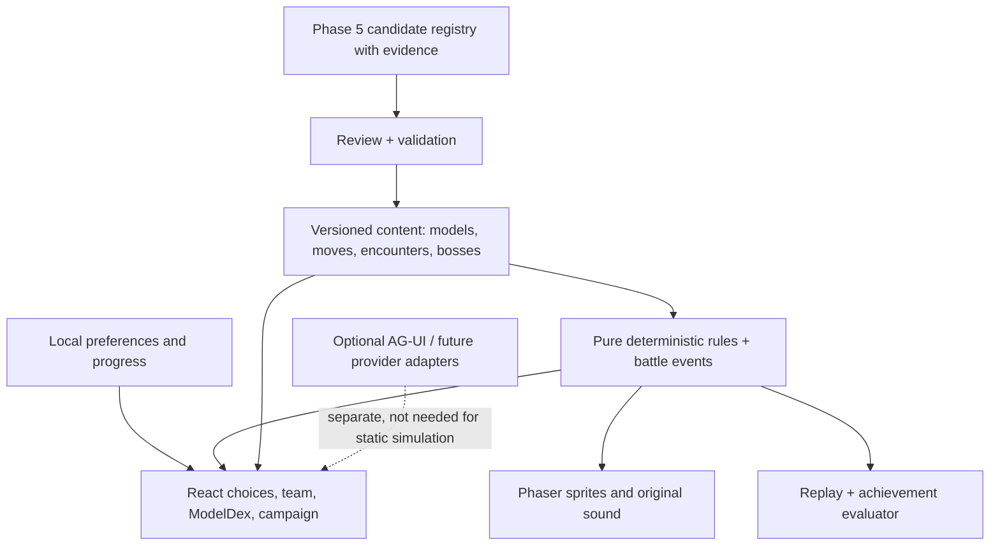

# Pokaimon Battle Evolution: five-phase expansion

**Status:** Phases 1–3 implemented and acceptance-tested on this branch; Phase 4 replay/challenges implemented with an additional combo effect awaiting final QA; Phase 5 registry, source review, candidate importer and fourth playable model implemented with final CI and screen review pending. See [TASKS.md](TASKS.md) for evidence and blockers.
**Planning baseline:** `main` at `70be65c372b8e785abb3fa0d0fea5d993194d9da` (merged PR #3, November 20, 2026).
**Working branch:** `feat/battle-evolution`; this branch begins from that baseline. [Draft PR #4](https://github.com/Danejw/Pokaimon/pull/4). No overworld in these five phases.
**Scope:** Expand the existing browser battle into a fun, strategically deep, progressively unlockable, replayable AI-literacy game and make future model releases easy to incorporate.

> This is a **post-MVP plan**. Its Phase 1–5 numbers are separate from the completed historical MVP Phase 0–4 in [../IMPLEMENTATION_PLAN.md](../IMPLEMENTATION_PLAN.md). The currently deployed game and source code are the implementation baseline, not these proposals. Mark completion only after tests, screenshots, and playtesting.

## Read the plan in order

| Phase | Plan | Playable outcome | Depends on |
| --- | --- | --- | --- |
| 1 | [Battle System 2.0](PHASE_1_BATTLE_SYSTEM.md) | Team switching, distinctive tactics, counterplay and combos inside one encounter | Current stable battle |
| 2 | [ModelDex and Team Building](PHASE_2_MODELDEX_TEAM.md) | Manage roster, select team, discover mastery, keep progress | 1 |
| 3 | [Campaign and Boss Battles](PHASE_3_CAMPAIGN_BOSSES.md) | Chapters, rivals, bosses, persistent victories, optional Quick Play | 2 |
| 4 | [Replayability and Game Feel](PHASE_4_REPLAYABILITY_FEEL.md) | Varied repeatable challenges, replay, achievements, better animations and sound | 3 |
| 5 | [Living Model Ecosystem](PHASE_5_LIVING_ROSTER.md) | Validated model registry and safe candidate-import workflow for new releases | 4 |

Track execution in [TASKS.md](TASKS.md). Each phase file provides sequenced vertical slices, affected code, game rules, verification tests and exit gate. Work **serially**: complete, test, visually inspect and document one phase before starting the next; no speculative Phase 5 infrastructure during Phase 1.

## Verified implementation baseline from source (Nov 20)

- React + Vite UI, Phaser fixed side-view battle stage, original programmatic sprites and synthesized audio. Static GitHub Pages at `/Pokaimon/`.
- `src/battle/engine.ts` is a deterministic reducer. One chosen model per battle, four moves per model, **6 AP**, turn cap **8**, staged progress, turn-two enemy special, win/lose/retry.
- `src/battle/types.ts` supports five capabilities: reasoning, research, coding, verification, context. `src/content/core.ts` has **3 playable models**, 9 move definitions; `src/content/encounters.ts` has **5** encounters.
- `src/game/BattlePanel.tsx` owns selection, animation phases, command UI and results. `src/game/BattleStage.tsx` renders the visual stage.
- `src/storage/progress.ts` stores only completed encounter IDs (schema 1). `src/storage/preferences.ts` stores sound, motion, text speed and difficulty (Easy, **Medium default**, Hard). Difficulty currently changes **information shown**, not battle math.
- `src/battle/tactics.ts` provides simulated move forecasts, stage intel and victory medals. `src/integrations/agui/` and `server/` provide an optional local AG-UI integration; the static site makes **no provider calls**.
- Existing tests: Vitest battle/roster/encounter/unit coverage and Playwright mobile/desktop battle flows. Known limitation: current tests and screenshots must be rerun after each meaningful change; no real-phone QA is established by this plan.

## Product contract and boundaries

1. **Fun decisions first.** Every new mechanic must yield at least two sensible choices and feedback that lets players learn by trial and error. Avoid a solved move-color matching exercise or forced tutorial text.
2. **Two truth layers.** Gameplay powers, costs, matchups, enemy HP, rarity, scores and rewards are fictional **simulated balance data**. Separately, model metadata and supported capabilities require dated, verifiable sources. Never equate an arena win with a live benchmark or actual work completion.
3. **Difficulty controls disclosure.** Easy shows forecasts/hints, Medium hides numeric gains and optimal-move answers but explains techniques, Hard hides technique previews/forecasts. **Challenge tiers**, introduced in Phase 4, affect mechanics separately. No silent change to existing difficulty defaults.
4. **Determinism.** Rules are pure data + state transitions. Same initial content version, seed and actions produce the same result and replay; all visuals and audio are derived from events. If any seeded randomness is introduced, seed it explicitly.
5. **Static, free and offline-friendly after load.** Keep GitHub Pages, local progress, no required login, server, paid API, persistent computer or provider execution. AG-UI remains an optional boundary and must not leak into battle rules.
6. **Original art/audio, inclusive input.** No Pokémon assets or franchise trade dress. Phone portrait touch targets, keyboard controls, clear focus, mute, reduced motion, readable captions and accessible status messages are non-negotiable.
7. **Simple, data-driven, reversible.** Reuse existing content registries until a demonstrated need to split them. No new package, service, generator or schema until its slice uses it. Do not rewrite the app just to reorganize code.
8. **Preserve existing progress.** New storage schemas must migrate saved `pokaimon:progress:v1`; tolerate corrupt/old data, never reset players silently, preserve preference defaults.
9. **No overworld yet.** Trainer walking, map exploration, multiplayer, matchmaking, ranked providers, real AI calls and monetization are out of scope for the five phases.

## Execution contract: one verified vertical slice at a time

For every numbered slice: **inspect live code/main and prior phase evidence → write meaningful failing unit and browser acceptance tests → implement complete player path (rules + input + output + feedback + persistence where applicable) → run CI → inspect 360×800, 390×844 and desktop screenshots → manually play representative win/loss → record what actually passed and unresolved design tradeoffs → commit**. Keep pure reducer tests independent of React. Use `npm run lint`, `npm run typecheck`, `npm run test`, `npm run test:agui`, `npm run build`, `npm run test:e2e`. Report exceptions explicitly.

Use the **same `feat/battle-evolution` branch** for this serial project unless the user directs otherwise. Keep commits grouped by vertical slice with phase prefixes (`phase1:`, etc.), and review each phase's cumulative diff before beginning the next. Do not merge or force-update `main` without explicit instruction. A draft PR can gather CI and feedback; green CI is necessary, not proof of engaging gameplay.

**End-of-phase release gate:**
- [ ] Acceptance criteria and negative-path cases pass at code and browser level.
- [ ] Baseline battles and all Easy/Medium/Hard paths still work.
- [ ] Win, lose, retry, return, reload and save/migration flows work.
- [ ] Mobile 360×800 and 390×844 + desktop screenshots inspected and no clipped/hidden controls.
- [ ] Representative keyboard/touch, reduced-motion, muted, and accessibility flows inspected.
- [ ] At least two full hands-on playthroughs (one successful, one losing) recorded with evidence; tuning changes justified.
- [ ] Tests/CI, references and remaining risks linked in [TASKS.md](TASKS.md). Phase marked complete only then.

## Planned code boundaries

**Core contracts will evolve carefully:** `BattleState` tracks active team and statuses (Phase 1); `Progress` adds unlocks and mastery (Phase 2); a campaign record references stable encounter IDs (Phase 3); a content-versioned replay seed and action history (Phase 4); a verified model registry + independent balance profile feeds the same existing content adapters (Phase 5). All new fields need migration, validation and backward-compatibility tests.

## Design decisions to validate before implementation

- Phase 1 proposes switches consume **one turn but zero AP**; test actual fairness against six-AP encounters before fixing that choice. Switches should be tactical, not spammed; enemy counter timing must be consistent.
- Phase 1 proposes only a small number of clear combo/status effects. Never use unbounded condition stacks.
- Phase 2 starts with the three already documented models freely playable. Rarity never implies real-world model quality. Lock only later content that has actually been shipped and is winnable.
- Phase 3 adds **Campaign** alongside the current random **Quick Play**, retaining a one-click entry to battle.
- Phase 4 uses seed-driven templates and a small valid encounter pool; do not auto-generate misleading real-world task outcomes with an LLM.
- Phase 5 **automates discovery and candidate creation**, while publication still requires grounded evidence and human review. No automatic claim that a new model is superior.

## Review sequence

Read [Phase 1](PHASE_1_BATTLE_SYSTEM.md) first, agree on the switch economy and two playable strategies, then implement 1A. Advance only after completing the phase gate. The five phase files are specifications and execution references and may be refined when playtests reveal better mechanics; document such decisions rather than silently shifting scope.
